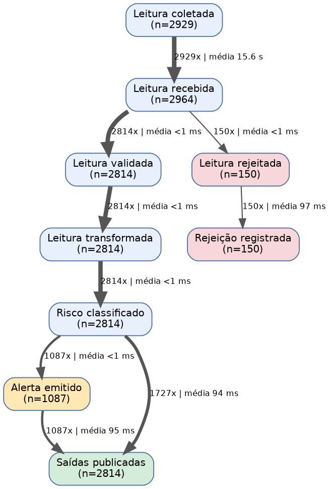

# Análise de processo (mineração de processos) - AgroSmart

Event log: **2964 casos** (1 caso = 1 leitura de sensor), **18536 eventos**, **4 variantes**, de 2026-11-22 01:33:13 a 2026-11-22 03:11:16.624000.
Tempo de ponta a ponta por leitura (coleta → publicação): média **15.5 s**, p95 **29.2 s**.

## Representação do processo

## Variantes (caminhos percorridos)

| Variante | Casos | % | Caminho |
|---|---|---|--,-|
| V1 | 1727 | 58.3 | Coletada → Recebida → Validada → Transformada → Classificada → Publicada |
| V2 | 1087 | 36.7 | Coletada → Recebida → Validada → Transformada → Classificada → Alerta emitido → Publicada |
| V3 | 115 | 3.9 | Coletada → Recebida → Rejeitada → Rejeição registrada |
| V4 | 35 | 1.2 | Recebida → Rejeitada → Rejeição registrada |

Leituras por nível de risco: NORMAL: 1727, ATENÇÃO: 987, CRÍTICO: 100.
Motivos de rejeição: campo nulo ou ausente: 58, JSON inválido: 35, valor fora da faixa (sensor suspeito): 30, registro duplicado: 27.

## Tempos entre etapas

| De | Para | Casos | Média | P95 | Máx. |
|---|---|---|---|---|---|
| Leitura coletada | Leitura recebida | 2929 | 15.6 s | 29.2 s | 31.1 s |
| Risco classificado | Saídas publicadas | 1727 | 94 ms | 152 ms | 241 ms |
| Alerta emitido | Saídas publicadas | 1087 | 95 ms | 150 ms | 241 ms |
| Leitura rejeitada | Rejeição registrada | 150 | 97 ms | 156 ms | 237 ms |
| Leitura recebida | Leitura validada | 2814 | <1 ms | <1 ms | 1 ms |
| Leitura validada | Leitura transformada | 2814 | <1 ms | <1 ms | 1 ms |
| Leitura transformada | Risco classificado | 2814 | <1 ms | <1 ms | 1 ms |
| Leitura recebida | Leitura rejeitada | 150 | <1 ms | <1 ms | 1 ms |
| Risco classificado | Alerta emitido | 1087 | <1 ms | <1 ms | <1 ms |

## Insights

**Gargalo.** A transição *Leitura coletada* → *Leitura recebida* concentra 99.4% de todo o tempo gasto entre etapas (média de 15.6 s). As etapas de validação, transformação e classificação levam milissegundos: o tempo é de **espera**, não de processamento, porque o pipeline trabalha em lotes (ciclos) e a leitura aguarda o próximo ciclo.

**Variações.** O caminho mais comum (58.3% dos casos) é: Coletada → Recebida → Validada → Transformada → Classificada → Publicada. As demais variantes são desvios: leituras rejeitadas (5.1% dos casos) e leituras com alerta emitido (38.6% das leituras aceitas).

**Oportunidades de melhoria.**

1. Reduzir a espera entre coleta e processamento: diminuir o intervalo do ciclo ou processar por evento (fila/MQTT), eliminando a espera do lote.
2. Fechar o fluxo do alerta: hoje o processo termina em 'Saídas publicadas'. Não há evento de ação executada (irrigação ligada, ventilação acionada); registrar esse evento permitiria medir o tempo entre alerta e ação.
3. Tratar o volume de alertas (38.6% das leituras aceitas): usar tolerância (por exemplo, exigir 2 leituras seguidas fora da faixa) para reduzir alertas por ruído.
4. Monitorar a taxa de rejeição (5.1%): uma alta persistente indica sensor defeituoso ou problema de transmissão, e pode virar um alerta próprio.

> Observação: as leituras vêm de um simulador; os tempos refletem o ambiente de teste.
